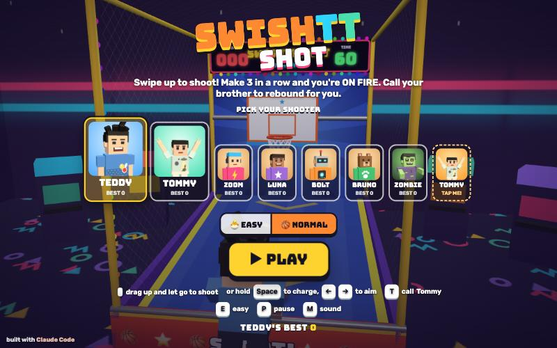

# SwishTT Shot

[](https://adong.github.io/swishtt-shot/)

Press **?** any time (or tap the round **?** button on the left edge) to see the keys. The game waits while you look.

An arcade basketball shooting machine (投篮机) starring Teddy and his jump shot. You stand at the end of a neon arcade machine and shoot at a hoop on a sliding backboard. A ramp rolls every ball back to your feet, and the clock gives you 60 seconds a round. It's built with Claude Code from plain JavaScript and Three.js, in the same style as Metro Surfer and the other Teddy & Tommy games.
There are no image, model or audio files. The machine, the room and the ball are boxes, spheres and canvas-painted textures, the characters come from the shared kit (`kit/`), and every sound is synthesised.

The name lives in one place, [js/title.js](js/title.js). Alan named it SwishTT Shot. (BuckeTT Bros is the separate 2-on-2 street basketball game.)

## Play

- **Double-click `index.html`.** It works offline, because Three.js and the kit are copied into `kit/`. Without internet the logo falls back from the Bungee font to Arial Black.
- **Send one file:** `dist/hoops-teddy.html` is the whole game in one file. AirDrop or email it, then open it in a browser.
- **Rebuild that file** after any edit: `python3 kit/tools/bundle.py . --name hoops-teddy`
- **Get kit updates** from `~/claude-games/kit`: `python3 ../kit/tools/sync.py .`, then rebuild.
- **Saved per browser:** each shooter's best score, his EASY/NORMAL setting and the last shooter picked. `index.html` and `dist/hoops-teddy.html` each keep their own, because they're different ways of opening the game.

| Mouse | Touch | Keys | |
|---|---|---|---|
| hold the button, drag up, let go | swipe up | hold `Space`, let go | shoot |
| drag to the left or right | swipe to the left or right | `←` `→` | aim |
| a longer drag | a longer swipe | how long you hold `Space` | power |
| buddy button (bottom right) or his title card | same | `T` | call your brother to rebound |
| click a card | tap a card | `←` `→` on the title | pick your shooter |
| 🐣 EASY / 🏀 NORMAL | same | `E` on the title | how hard |
| ▶ PLAY | ▶ PLAY | `Enter` (or `Space` on the title) | start, or play again |
| ❚❚ button | ❚❚ button | `P` / `Esc` | pause |
| 🔊 button | 🔊 button | `M` | sound on/off |

## How it plays

- **Shooting.** Drag or swipe up anywhere on the screen. A straight-up swipe goes straight down the machine, and leaning it left or right aims that way. The swipe's length is the power: a short swipe falls short and a long one hits the top of the board. While you drag, an arrow and a ring show the power. Your shooter crouches with the ball, and when you let go he does Teddy's jump shot (`jumpshot`), and the ball leaves his fingertips at the top of the jump. Every shot leaves at the same 55° arc, so aim and power are the only two things to learn.
- **Keyboard.** Hold `Space` and the power rises and falls; let go to shoot. `←` and `→` move the aim, and a short dotted arc shows where it's going.
- **Aim help.** A shot that's nearly right gets pulled toward the perfect one, which drops through the middle and leads a sliding hoop. EASY pulls hard: Tommy's swipes go in about three times out of four. NORMAL only helps a little. EASY also has a bigger rim and shows the whole arc while you aim. The arc turns **green when it's going in**, so let go.
- **The machine.** Three balls are in play. After each shot the ball drops onto the padded ramp and rolls back to the tray at your feet in about 2 seconds, and your shooter grabs the next one. The side and top nets keep every ball in. A ball that bounces out over the front pops back onto the ramp.
- **Points.** A basket is 2 points and a swish (nothing but net) is 3.
- **🔥 ON FIRE.** Make 3 in a row and you're ON FIRE: every shot is a flaming ball worth double, the lights chase red and orange, and the screen glows. It lasts until you miss.
- **Rounds.** Each round lasts 60 seconds and has a goal. Reach it and you clear the round, with confetti and a celebration, and the next one starts. If time runs out short of the goal, the game is over. Balls already in the air when the buzzer goes still count (BUZZER BEATER!). The hoop stays still in round 1, then slides left and right from round 2, a little wider and faster each round. EASY slides less and slower.

  | Round | 1 | 2 | 3 | 4 | 5 | 6+ |
  |---|---|---|---|---|---|---|
  | NORMAL goal | 20 | 22 | 24 | 26 | 28 | +2 each |
  | EASY goal | 10 | 12 | 14 | 16 | 18 | +2 each |
  | hoop slide (NORMAL) | still | ±0.6 m, 9 s | ±0.9 m, 8 s | ±1.1 m, 7 s | ±1.25 m, 6.5 s | ±1.35 m, faster |

- **Celebrations.** Teddy celebrates with his Tyson-style boxing (jab, straight) and Tommy with his Y and peace fingers. Everyone else waves. He turns to face you for it. Going ON FIRE and clearing a round always get one. After an ordinary basket he only celebrates while he's waiting for a ball, so it never costs you time.
- **The title screen** plays by itself: your shooter takes shots while you pick, and you can swipe to practise.
- All the numbers are at the top of `js/game.js` (rounds, goals, slides, aim help) and `js/physics.js` (sizes, bounciness, ramp).

## Your brother, the rebounder

Tap the big orange button with his face (bottom right), press **T**, or tap his dashed **TAP ME!** card on the title screen. The other brother hops into the machine under the hoop: Tommy for everyone, or Teddy when Tommy is shooting (`Kit.roster.buddyFor`). It's modelled on the buddy in Metro Surfer. A visit lasts about 10 seconds:

- He hops in over the side wearing a name tag, and says hi with his signature move: Tommy's Y, or Teddy's boxing.
- He throws you a treat (🍦 💧 🧃 🍪 🍉 🍌) with a toast like "🍦 ICE CREAM FROM TOMMY!". It lands on the shelf on the front of the machine, where your treats line up.
- **He rebounds.** He runs under each ball as it comes down, catches it, and passes it straight back into your hands with a little cheer. That's about twice as fast as the ramp.
- **He saves your streak.** While he's there, a miss doesn't break your streak or put out your fire: "TOMMY SAVED YOUR STREAK!" His button glows, and a bar with his face and a 🛡️ under your score shows the time left.
- Then he says bye with his goodbye move (Tommy's Y again, or Teddy's jump shot) and hops out.
- Call him as often as you like. Tapping again after his treat makes him say hi again and bring another one. Tapping before it adds an extra treat, and tapping while he's leaving brings him straight back.

## How it was checked

**Physics, headless:** `node tools/check-physics.js` runs `js/physics.js` (the same file the page uses) without a browser. All 14 checks pass in about 4 s:

- A well-aimed shot (`Phys.ideal`) swishes on both rim sizes, with the hoop still and at 48 points on its slide in four slide speeds.
- Near misses of it sometimes rattle in (36 of 45).
- **No ball ever gets stuck on the rim:**
  - A sweep of 20,910 shots (every aim from -30° to 30° by 1.5°, every power by 0.02, five hoop positions, both rims) all come back to the tray, the slowest in 4.7 s.
  - None stays near the rim for 2 s; the longest is 1.5 s.
  - Balls dropped right on top of the rim (24 spots around it), wedged between rim and board, on the bracket and on top of the backboard all roll off.
  - 40 quick-fire volleys of 4 balls all come back.
- The safety net is in `substep()`. A slow ball held up by the rim, board or nets gets nudged toward the middle of the hoop after 0.6 s. After three nudges it's put back in the tray. The sweep never needed it; only the balls placed on the rim did.

**Hit rates, in the page:** a "kid bot" swipes at the hoop through the real swipe-to-aim mapping and the aim help, with wobble added to the angle and length, and plays it out in a separate physics world.

| Shooter | Round 1 | Round 2 | Round 3 | Round 4 |
|---|---|---|---|---|
| EASY, wobbly (±12°, ±25 %) | 73 % | 69–75 % | 58–66 % | 43–61 % |
| NORMAL, steady (±8°, ±18 %) | 42 % | 14–34 % | 6–19 % | 6–14 % |

On moving hoops, the low number is a bot that aims where the hoop is now and the high number is a bot that leads it a little. A scripted perfect shooter cleared round 1 with 171 points and kept swishing the moving hoop in rounds 2 and 3.

**In the Browser pane** (`requestAnimationFrame` is throttled while the pane is hidden, so tests drive time themselves):

```js
game.autoPause = false; game.hold(true)  // only game.step() moves time (the page keeps drawing)
game.start('tommy', { level: 'easy' })   // start a game
game.step(3.5)                           // advance 3.5 s, drawing every frame
game.shoot(...game.idealArgs())          // a scripted perfect shot; game.shoot(angle, power) for any other
game.ideal()                             // { angle, power, flight } of the perfect shot right now
game.swipe(x0, y0, x1, y1)               // a real swipe through the pointer-event path (CSS px)
game.dragTo(x0, y0, x1, y1); game.release() // hold a drag (to see the guide), then let go
game.buddy(); game.buddyInfo()           // call the brother; his visit, catches, passes
game.setRound(3); game.setTime(5); game.setStreak(3); game.celebrate()
game.info()                              // state, score, streak, fire, every ball, the buddy
```

- **Flows:** title → countdown → 60 s → buzzer → ROUND CLEAR → round 2 with the hoop sliding, and TIME'S UP → game over with best scores per shooter.
- **Inputs:** the pointer swipe path, a held drag and release, Space charge with the arrow keys, pause and resume.
- **Buddy:** both pairings. A miss while he's guarding keeps the streak, and after he leaves a miss resets it. All the toasts appeared.
- **Screens:** desktop, iPad portrait, phone portrait and a phone on its side.
- **Sounds:** every sound runs without errors.

## Files

```
index.html             page, HUD and screens (CSS inline)
js/title.js            the game's name, in one place
js/physics.js          ball physics: rim (torus), backboard, ramp, nets, tray; shots, the perfect shot, the guide arc.
                       No Three.js, so it also runs in Node
js/sfx.js              rim, board, bounce, net, cheer, crowd, fire, buzzer, fanfare... built on Kit.sound.tone / hiss
js/arena.js            the room, the machine, the sliding backboard, the verlet net, balls, flames, particles,
                       the aim guide, the treat shelf, the camera
js/players.js          extra poses (hold, aim, ready, catch, pass, yay) and the shooter: jump shot, celebrations
js/buddy.js            the brother: his visit, catching and passing, treats, streak saving
js/game.js             rounds, input, aim help, scoring, ON FIRE, HUD, screens, main loop, window.game
tools/check-physics.js the headless physics check (node tools/check-physics.js)
kit/                   copy of ~/claude-games/kit (Three.js r149, people, roster, portraits, sound, bundler);
                       edit the kit there, not here
dist/hoops-teddy.html  the single-file build
```

## Kit candidates

These live in this game for now. Move them into `~/claude-games/kit` if another game wants them (the Hoops '96-style game, say):

- **Basketball physics** (`js/physics.js`): sphere against a torus rim, boxes and planes, with resting contact that settles instead of jittering. It also has the "never stuck" nudge, the perfect-shot solver that leads a moving hoop, and a headless test harness.
- **A net that wobbles** (`buildNet` / `updateNet` in `js/arena.js`): a diamond-mesh verlet net hung on a rim, pushed by balls and drawn with one instanced mesh.
- **Particles with their own size and colour fade** (`makeParticles` in `js/arena.js`): a small point-sprite shader, used for flames, sparkles and confetti.
- **Ball-handling poses** (`HT.pose` in `js/players.js`): `hold`, `aim`, `ready`, `catch`, `pass`, `yay`. Also `ballSpot()`, where a two-handed ball sits.
- **Standing celebrations:** like the siblings found, `peace`, `wave` and `give` stride; a standing person damps the legs after `Kit.people.pose`.
- **Sounds** in `js/sfx.js`: `rim`, `board`, `bounce`, `net`, `cheer`, `crowd`, `fire`, `buzzer`, `beep`, `tick`, `fanfare`, `aww`, `treat`, `poof`.

## Not verified

- **Sound:** every effect and the music run through Web Audio without errors, but no one has listened to them yet.
- **Real touch devices:** touch uses the same pointer events as the mouse, tested with synthetic pointer swipes and in phone and iPad emulation. It hasn't been tried with fingers on a real iPad or phone, or in iOS Safari. The swipe length needed for a good shot is about a third of the screen's height. That may need tuning once Teddy and Tommy try it.
- **file://:** the page uses only classic `<script src>` tags and no fetches, so double-click should work. The Browser pane can't open `file://` pages, so it was tested from a local server.
